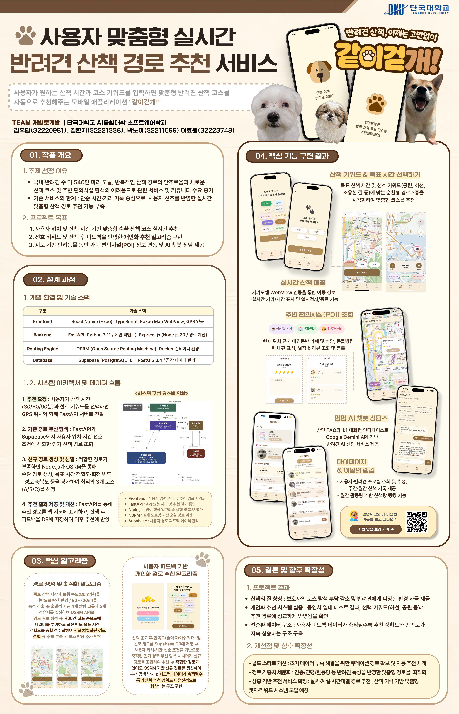

<h1 align="center">🐾 같이걷개! 🐾</h1>

  "반려견 산책, 이제는 고민 없이!"

<h3 align="center">
  사용자 맞춤형 실시간 반려견 산책 경로 추천 서비스
</h3>

## 1. 팀 및 팀원 소개

**🦴 팀명: Team 개발로 개발**

**🏫 소속: 단국대학교 AI융합대학 소프트웨어학과**

<table>
  <thead>
    <tr>
      <th width="100">이름</th>
      <th width="100">학번</th>
      <th width="190">역할</th>
      <th>세부 업무</th>
    </tr>
  </thead>
  <tbody>
    <tr>
      <td nowrap><b>김유담</b></td>
      <td nowrap>32220981</td>
      <td>Backend (FastAPI + DB)</td>
      <td>FastAPI 라우터, PostgreSQL + PostGIS 설계, 비밀번호 찾기, 랭킹 연동</td>
    </tr>
    <tr>
      <td nowrap><b>김현채</b></td>
      <td nowrap>32221338</td>
      <td>Backend · 팀장 (Node.js + OSRM)</td>
      <td>경로 추천 알고리즘(recommend.js), OSRM Docker 연동, 회원가입 및 로그인 서비스 구현, 취향 카테고리 DB 연동</td>
    </tr>
    <tr>
      <td nowrap><b>박노아</b></td>
      <td nowrap>32211599</td>
      <td>Frontend</td>
      <td>랭킹·커뮤니티·프로필 탭, GPS 연동, JWT 인증 저장</td>
    </tr>
    <tr>
      <td nowrap><b>이효원</b></td>
      <td nowrap>32223748</td>
      <td>Frontend</td>
      <td>앱 UI/UX 디자인, 산책 경로 로직 및 카테고리 필터링, 개인화 서비스 및 챗봇 페이지 개발</td>
    </tr>
  </tbody>
</table>

---

## 2. 프로젝트 개요

**🐕 같이걷개!(Dogwalk)**는 사용자의 산책 시간에 맞춰 최적의 반려견 산책 경로를 추천하고, 산책 전후 평가 데이터를 반영하여 개인화된 경로를 제공하는 모바일 애플리케이션입니다.

이를 통해 사용자와 반려견 모두에게 효율적이고 만족도 높은 산책 경험을 제공하는 것을 목표로 합니다.

### 주요 기능

**🗺️ 맞춤형 산책 경로 추천**

- 사용자의 현재 위치, 희망 산책 시간(30·60·90분), 선호 키워드(하천, 차 없는 길 등)를 기반으로 최적의 산책 경로 3개 추천
- 실시간 GPS를 활용한 산책 경로 안내 및 산책 종료 후 평가를 통한 개인화 추천

**🏆 이달의 산책왕 랭킹 기능**

- 사용자별 산책 활동량을 기반으로 월간 랭킹 제공
- 다른 사용자와 산책 기록을 비교하며 지속적인 산책 참여 동기 부여

**🐶 사용자 및 반려견 프로필 관리**

- 사용자 정보와 반려견 프로필 등록 및 수정
- 개인별 산책 기록과 활동 이력을 확인하고 관리할 수 있는 마이페이지 제공

**🤖 반려견 상담 AI 챗봇**

- Google Gemini AI를 활용한 반려견 관련 질문 및 상담 서비스
- 반려견 건강, 행동, 산책 등 다양한 주제에 대한 맞춤형 답변 제공

### 사용 기술 및 시스템 아키텍처

| 구분 | 기술 스택 |
|:---:|---|
| **Frontend** | React Native (Expo), TypeScript, Kakao Map WebView, GPS 연동 |
| **Backend** | FastAPI (Python 3.11 / 메인 백엔드), Express.js (Node.js 20 / 경로 계산) |
| **Routing Engine** | OSRM (Open Source Routing Machine), Docker 컨테이너 환경 |
| **Database** | Supabase (PostgreSQL 16 + PostGIS 3.4 / 공간 데이터 관리) |
| **AI** | Google Gemini 2.5 Flash Lite |

---

## 3. 실행 환경 및 방법

👉 [같이걷개! 실행 가이드](./frontend/README.md)

---

## 4. 시연 영상

👉 [같이걷개! 시연 영상](https://www.youtube.com/watch?si=xo0iMZguorsXAbT9&v=30mEUgaWlh8&feature=youtu.be)

---

## 5. 결과 보고서

👉 [최종 결과 보고서 다운로드 (PDF)](https://github.com/dogwalk-labs/dogwalk/raw/main/docs/dogwalk_final_report.pdf)

---

## 6. 발표 자료

| 구분 | 다운로드 |
|------|----------|
| 중간 발표 자료 | 👉 [중간 발표 다운로드 (PDF)](https://github.com/dogwalk-labs/dogwalk/raw/main/docs/dogwalk_mid_presentation.pdf) |
| 기술 발표 자료 | 👉 [기술 발표 다운로드 (PDF)](https://github.com/dogwalk-labs/dogwalk/raw/main/docs/dogwalk_tech_presentation.pdf) |
| 최종 발표 자료 | 👉 [최종 발표 다운로드 (PDF)](https://github.com/dogwalk-labs/dogwalk/raw/main/docs/dogwalk_final_presentation.pdf) |

---
