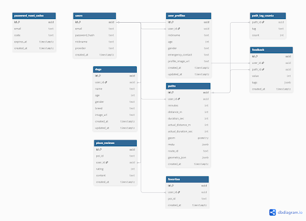

<div align="center">


<h3 align="center">
  사용자 맞춤형 실시간 반려견 산책 경로 추천 서비스
</h3>

<h1 align="center">🐾 같이걷개! 🐾</h1>

<hr width="100%">

<p align="center">
  "반려견 산책, 이제는 고민 없이!"
</p>

</div>

<br>


👉 [같이걷개! 포스터 다운로드 (PNG)](https://github.com/dogwalk-labs/dogwalk/raw/main/docs/dogwalkposter.png)

<br>

---

## 1. 팀 및 팀원 소개

**🦴 팀명: Team 개발로 개발**

**🏫 소속: 단국대학교 AI융합대학 소프트웨어학과**

<table>
  <thead>
    <tr>
      <th width="100">이름</th>
      <th width="100">학번</th>
      <th width="190">역할</th>
      <th>세부 업무</th>
    </tr>
  </thead>
  <tbody>
    <tr>
      <td nowrap><b>김유담</b></td>
      <td nowrap>32220981</td>
      <td>Backend (FastAPI + DB)</td>
      <td>FastAPI 라우터, PostgreSQL + PostGIS 설계, 비밀번호 찾기, 랭킹 연동</td>
    </tr>
    <tr>
      <td nowrap><b>김현채</b></td>
      <td nowrap>32221338</td>
      <td>Backend · 팀장 (Node.js + OSRM)</td>
      <td>경로 추천 알고리즘(recommend.js), OSRM Docker 연동, 회원가입 및 로그인 서비스 구현, 취향 카테고리 DB 연동</td>
    </tr>
    <tr>
      <td nowrap><b>박노아</b></td>
      <td nowrap>32211599</td>
      <td>Frontend</td>
      <td>랭킹·커뮤니티·프로필 탭, GPS 연동, JWT 인증 저장</td>
    </tr>
    <tr>
      <td nowrap><b>이효원</b></td>
      <td nowrap>32223748</td>
      <td>Frontend</td>
      <td>앱 UI/UX 디자인, 산책 경로 로직 및 카테고리 필터링, 개인화 서비스 및 챗봇 페이지 개발</td>
    </tr>
  </tbody>
</table>

---

## 2. 프로젝트 개요

<div align="center">

<p>
  <strong>🐕 같이걷개!(Dogwalk)</strong>는 사용자의 산책 시간에 맞춰 최적의 반려견 산책 경로를 추천하고, 산책 전후 평가 데이터를 반영하여 개인화된 경로를 제공하는 모바일 애플리케이션입니다.
</p>

<p>
  이를 통해 사용자와 반려견 모두에게 효율적이고 만족도 높은 산책 경험을 제공하는 것을 목표로 합니다.
</p>

</div>

### 1) 주요 기능

**🗺️ 맞춤형 산책 경로 추천**

- 사용자의 현재 위치, 희망 산책 시간(30·60·90분), 선호 키워드(하천, 차 없는 길 등)를 기반으로 최적의 산책 경로 3개 추천
- 실시간 GPS를 활용한 산책 경로 안내 및 산책 종료 후 평가를 통한 개인화 추천

**🏆 이달의 산책왕 랭킹 기능**

- 사용자별 산책 활동량을 기반으로 월간 랭킹 제공
- 다른 사용자와 산책 기록을 비교하며 지속적인 산책 참여 동기 부여

**🐶 사용자 및 반려견 프로필 관리**

- 사용자 정보와 반려견 프로필 등록 및 수정
- 개인별 산책 기록과 활동 이력을 확인하고 관리할 수 있는 마이페이지 제공

**🤖 반려견 상담 AI 챗봇**

- Google Gemini AI를 활용한 반려견 관련 질문 및 상담 서비스
- 반려견 건강, 행동, 산책 등 다양한 주제에 대한 맞춤형 답변 제공

### 2) 사용 기술 및 시스템 아키텍처

| 구분 | 기술 스택 |
|:---:|---|
| **Frontend** | React Native (Expo), TypeScript, Kakao Map WebView, GPS 연동 |
| **Backend** | FastAPI (Python 3.11 / 메인 백엔드), Express.js (Node.js 20 / 경로 계산) |
| **Routing Engine** | OSRM (Open Source Routing Machine), Docker 컨테이너 환경 |
| **Database** | Supabase (PostgreSQL 16 + PostGIS 3.4 / 공간 데이터 관리) |
| **AI** | Google Gemini 2.5 Flash Lite |

#### 💻 Frontend


---

#### ⚙️ Backend


---

#### 🛣️ Routing Engine


---

#### 🗄️ Database


---

#### 🤖 AI


---

#### 🏗️ 시스템 아키텍처

<p align="center">
  
</p>

---

## 3. 실행 환경 및 방법

👉 [같이걷개! 실행 가이드](https://github.com/dogwalk-labs/dogwalk/blob/main/frontend/README.md)

### 📁 디렉터리 구조

```text
dogwalk-main/
├── frontend/                         # React Native · Expo 앱
│   ├── assets/                       # 이미지 및 앱 리소스
│   ├── auth/
│   │   └── authStorage.js            # 인증 정보 저장
│   ├── components/
│   │   └── BottomTabBar.js           # 하단 탭 컴포넌트
│   ├── config/
│   │   └── config.js                 # 앱 환경 설정
│   ├── lib/
│   │   ├── supabase.js               # Supabase 연동
│   │   └── uploadProfileImage.js     # 프로필 이미지 업로드
│   ├── screens/
│   │   ├── chatBot/                  # AI 챗봇 · 커뮤니티
│   │   ├── login/                    # 로그인 · 회원가입
│   │   ├── onboarding/               # 온보딩 화면
│   │   ├── profile/                  # 사용자 · 반려견 프로필
│   │   ├── ranking/                  # 산책 랭킹
│   │   ├── review/                   # 장소 리뷰
│   │   └── walk/                     # 산책 경로 추천 및 기록
│   │       ├── MapScreen.js
│   │       ├── RouteSelectScreen.js
│   │       ├── TimeSelectScreen.js
│   │       ├── WalkMapScreen.js
│   │       └── WalkReviewScreen.js
│   ├── App.js                         # 앱 진입점
│   ├── app.json                       # Expo 설정
│   ├── package.json                   # 프론트엔드 의존성
│   └── README.md                      # 실행 가이드
│
├── backend/
│   ├── api-python/                    # FastAPI 백엔드
│   │   ├── app/
│   │   │   ├── api/
│   │   │   │   ├── auth.py            # 인증 API
│   │   │   │   ├── feedback.py        # 평가 데이터 API
│   │   │   │   ├── paths.py           # 경로 API
│   │   │   │   ├── places.py          # 장소 API
│   │   │   │   ├── profile.py         # 프로필 API
│   │   │   │   ├── recommend_routes.py # 경로 추천 API
│   │   │   │   └── users.py           # 사용자 API
│   │   │   ├── core/
│   │   │   │   ├── config.py          # 환경 설정
│   │   │   │   ├── database.py        # DB 연결
│   │   │   │   └── security.py        # 보안 · 인증
│   │   │   ├── schemas/               # 데이터 스키마
│   │   │   └── main.py                # FastAPI 진입점
│   │   ├── Dockerfile
│   │   └── requirements.txt           # Python 의존성
│   │
│   ├── walk-backend/                  # Node.js · Express 서버
│   │   ├── data/                      # 장소 및 POI 데이터
│   │   ├── recommend/                 # 추천 관련 디렉터리
│   │   ├── recommend.js               # 경로 추천 알고리즘
│   │   ├── server.js                  # 서버 진입점
│   │   └── package.json               # Node.js 의존성
│   │
│   └── db/
│       └── init.sql                   # 데이터베이스 초기화
│
├── docs/                              # 프로젝트 문서
│   ├── datagram.png                   # 시스템 아키텍처
│   ├── dogwalkposter.png              # 프로젝트 포스터
│   ├── dogwalk_final_report.pdf       # 최종 결과 보고서
│   ├── dogwalk_mid_presentation.pdf   # 중간 발표
│   ├── dogwalk_tech_presentation.pdf  # 기술 발표
│   └── dogwalk_final_presentation.pdf # 최종 발표
│
├── docker-compose.yml                 # Docker 서비스 구성
├── package-lock.json
├── tree.txt                           # 디렉터리 목록
└── README.md                          # 프로젝트 소개
```

---

## 4. 시연 영상

👉 [같이걷개! 시연 영상](https://www.youtube.com/watch?si=xo0iMZguorsXAbT9&v=30mEUgaWlh8&feature=youtu.be)

---

## 5. 결과 보고서

👉 [최종 결과 보고서 다운로드 (PDF)](https://github.com/dogwalk-labs/dogwalk/raw/main/docs/dogwalk_final_report.pdf)

---

## 6. 발표 자료

| 구분 | 다운로드 |
|------|----------|
| 중간 발표 자료 | 👉 [중간 발표 다운로드 (PDF)](https://github.com/dogwalk-labs/dogwalk/raw/main/docs/dogwalk_mid_presentation.pdf) |
| 기술 발표 자료 | 👉 [기술 발표 다운로드 (PDF)](https://github.com/dogwalk-labs/dogwalk/raw/main/docs/dogwalk_tech_presentation.pdf) |
| 최종 발표 자료 | 👉 [최종 발표 다운로드 (PDF)](https://github.com/dogwalk-labs/dogwalk/raw/main/docs/dogwalk_final_presentation.pdf) |

---
